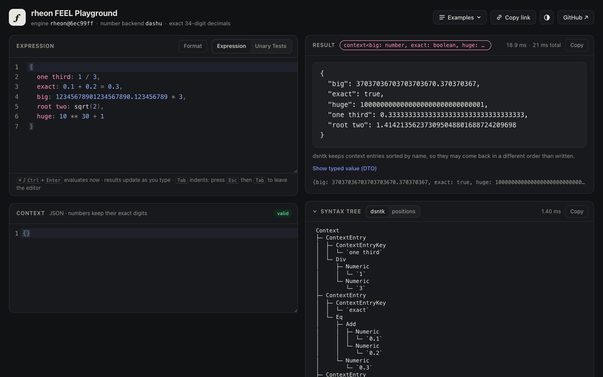

# rheon

[](https://crates.io/crates/rheon-feel-evaluator)
[](https://www.npmjs.com/package/@rheon/feel-runtime)
[](https://github.com/spearsandshields/rheon/actions/workflows/ci.yml)
[](#license)

**A decision engine you can embed anywhere: FEEL and DMN 1.6 in Rust, shipped as one
WebAssembly module that gives the same answer in the browser, in Node, on the server and inside
your own host.**

rheon (Greek ῥέον, "that which flows", the root of *panta rhei*) evaluates business rules written
in FEEL, the expression language of the OMG's DMN standard: `if`, `for`, filters, ranges, dates,
durations, contexts, 89 built-in functions, decision tables. It is written for the cases where
the answer matters: money, eligibility, pricing, compliance.

**[Try it in the playground](https://spearsandshields.github.io/rheon/)**. Everything runs in
your browser.

[](https://spearsandshields.github.io/rheon/)

```ts
import { FeelEngine } from '@rheon/feel-runtime';
import wasmUrl from '@rheon/feel-runtime/feel.wasm?url';   // Vite; or serve the file yourself

const engine = await FeelEngine.create({ wasmUrl });

await engine.evaluate({
  expression: 'price * quantity * (if loyalty tier = "gold" then 0.9 else 1)',
  context: { price: 12.5, quantity: 3, 'loyalty tier': 'gold' },
});
// → { ok: true, result: { display: "33.75", type: "number", … } }

await engine.evaluate({ expression: '0.1 + 0.2' });   // 0.3, not 0.30000000000000004
await engine.evaluate({ expression: '1/3' });         // 0.3333333333333333333333333333333333
```

## Where it is going

The FEEL and DMN engine is the foundation. The aim is an open, embeddable stack for decision
**and process** automation in Rust and WebAssembly: the building blocks to model, check and run
BPMN processes with the same properties the decision engine has today (one portable module, exact
answers, strict limits, no server required). In short, an alternative to heavyweight process
platforms that you link into your application instead of deploying beside it.

## Why rheon

**Exact decimal arithmetic.** Numbers are IEEE 754 decimal128 with 34 significant digits,
implemented in pure Rust. `exp`, `ln`, `log` and fractional `**` are correctly rounded (the exact
result, rounded once, half-even): `12.2384283 ** 4.25` is
`41959.85737359436186095331070746801`, where engines built on binary doubles stop at 16 digits. A
number oracle (Python `decimal`, exact rationals and mpmath) judges every numeric result of the
test corpus against DMN 1.6.

**The specification decides.** rheon targets DMN 1.6, the current formal version. It passes
3,392 of the 3,407 tests of the official DMN TCK; 14 of the 15 others need a Java virtual machine
for external functions. Features the TCK does not cover yet have 312 tests of their own in the
TCK's format. Where other engines are lenient and the specification is not, rheon follows the
specification, and [`docs/ENGINE-COMPARISON.md`](docs/ENGINE-COMPARISON.md) shows the differences
case by case.

**One module, every host.** `feel.wasm` is a single `wasm32-wasip1` module (about 760 KiB with
brotli) with a three-function ABI and JSON in and out. The same bytes run in a browser worker,
in Node and in any WASI runtime such as Wasmtime, so a rule gives the same answer in the form
that previews it and the service that enforces it. The build is reproducible: the same commit
and toolchain give a byte-identical module.

**Built for input you do not trust.** A rule typed by a user is a program. The engine bounds it:
300 levels of nesting, 200 nested calls, an optional step budget, 512 MiB of memory, and in the
JavaScript runtime a timeout that replaces the worker. A failure is an answer, never an
exception: a FEEL `null` carries the reason it is null, and errors say what was expected and what
was found (`comparison '<' expected number on the right, as on the left, found string`).

**An editor that reads a rule as the engine does.** The module answers editor requests from its
own parser: tokens for colouring, syntax errors with places, completion that knows the names in
scope, the signatures of the built-in functions and the type of the expression before a dot, and
a formatter. `@rheon/feel-codemirror` turns that into a CodeMirror 6 extension, so the editor
never disagrees with the evaluator about what a text means.

**No answer changes by accident.** Before a release, about 17,700 recorded requests run through
the previous release and the new build, and the full responses must be identical. Every
difference is registered with its reason, so the release notes list each answer that changed and
why.

**Fast enough to run per keystroke.** Measured in Node on an Apple M2, per request, through the
JSON boundary:

| Request | Median |
|---|---|
| `1 + 2` | 4 µs |
| Unary test `[18..65)` against an input | 5 µs |
| A date and time comparison across offsets | 7 µs |
| A formula of ten names over a context of 1,000 fields | 0.2 ms |
| `count(for i in 1..10000 return i)` | 0.4 ms |

## What is in the box

| You are building | Take | What you get |
|---|---|---|
| A web or Node application | [`@rheon/feel-runtime`](packages/feel-runtime/README.md) | `feel.wasm` and a typed runtime: a worker with a queue, timeouts, cancellation and crash recovery, and exact numbers across the boundary |
| A rule editor | [`@rheon/feel-codemirror`](packages/feel-codemirror/README.md) | Colours, error marks, typed completion, signature hints and formatting for CodeMirror 6 |
| A Rust program | `rheon-feel-parser`, `rheon-feel-evaluator`, `rheon-model-evaluator` on crates.io | The engine itself: the FEEL parser and evaluator, and the DMN model evaluator |
| A service in another language | `feel.wasm` from the [releases](https://github.com/spearsandshields/rheon/releases) | The module with its sha256, for any WASI runtime ([`docs/HOSTS.md`](docs/HOSTS.md), [`docs/CONTRACT.md`](docs/CONTRACT.md)) |

In Rust:

```rust
use rheon_feel::FeelScope;
use rheon_feel_evaluator::{evaluate, evaluate_context};
use rheon_feel_parser::parse_expression;

let scope = FeelScope::default();
let context = evaluate_context(&scope, r#"{ price: 12.50, quantity: 3, "loyalty tier": "gold" }"#)?;
let scope: FeelScope = context.into();

let rule = parse_expression(&scope, r#"price * quantity * (if loyalty tier = "gold" then 0.9 else 1)"#)?;
let value = evaluate(&scope, &rule).into_result()?;   // 33.75
```

## What works today

- **FEEL in WebAssembly**: expressions and unary tests, B-FEEL, lenient and strict error modes,
  typed results, several expressions over one context in one call, and the editor operations
  (`syntax`, `complete`, `outline`, `format`).
- **DMN 1.6 in the native engine**: the model evaluator with decision tables, boxed expressions,
  decision services and business knowledge models, behind the command line tool and server
  carried from dsntk. The DMN model evaluator is not in the wasm module yet.
- **The playground**: both dialects, a context editor that keeps every digit, the syntax tree,
  shareable links. It is a static site; host it anywhere.

rheon is at version 0.x: the wasm contract and the npm API grow by addition, and the Rust API of
the crates can change between minor versions. [`docs/LIMITATIONS.md`](docs/LIMITATIONS.md) lists
what the engine does not do (Java, PMML and ONNX external functions, time zone rules beyond a fixed offset) and
the limits it enforces; [`docs/BACKLOG.md`](docs/BACKLOG.md) lists known bugs.

## How it fits together

```
  your application
     │  evaluate / evaluateAll / parse / syntax / complete / outline / format
     ▼
  @rheon/feel-runtime ── compiles feel.wasm once; queue, timeout, cancellation,
     │                    crash → a fresh worker from the same compiled module
     ▼
  Web Worker ─────────── a 10-function WASI shim, no file system, no network
     │  feel_alloc / feel_call / feel_free      (JSON in, JSON out)
     ▼
  feel.wasm ──────────── rheon-feel-wasm (Rust)
                          parser · evaluator · temporal · decimal128 numbers
```

The module keeps nothing between calls. A host outside JavaScript calls the same three functions
directly.

## Documentation

| Document | What it covers |
|---|---|
| [`docs/CONTRACT.md`](docs/CONTRACT.md) | The wasm ABI and every request and response, field by field |
| [`docs/HOSTS.md`](docs/HOSTS.md) | Running the module in Wasmtime and other WASI hosts: stack, fuel, memory, threads |
| [`docs/LIMITATIONS.md`](docs/LIMITATIONS.md) | Limits, unsupported features and behaviours worth knowing |
| [`docs/ENGINE-COMPARISON.md`](docs/ENGINE-COMPARISON.md) | Edge cases side by side with other FEEL engines |
| [`docs/DEVELOPING.md`](docs/DEVELOPING.md) | Repository layout, building from source, the test tiers |
| [`docs/FORK.md`](docs/FORK.md) | Every engine change against upstream up to 0.9.0 |

## Relationship to dsntk

rheon builds on [dsntk](https://github.com/dsntk/dsntk-rs) (DecisionToolkit, by Dariusz Depta),
the Rust FEEL and DMN engine, as a permanent fork developed in its own direction. On top of it
rheon adds the pure-Rust decimal128 core, a parser written by hand, a rewritten evaluator, the
WebAssembly build, the editor operations, the TypeScript packages and more than 250 recorded
engine changes. The crates rheon has changed are published as `rheon-*`.

rheon is an independent project. It is not affiliated with, endorsed by or supported by
DecisionToolkit, Engos Software or the Object Management Group. "DMN", "FEEL" and "BPMN" are
trademarks of the OMG.

## License

rheon is licensed under either of the Apache License 2.0 ([`LICENSE`](LICENSE)) or the MIT
license ([`LICENSE-MIT`](LICENSE-MIT)), at your option, the same terms as dsntk, whose copyright
notices are retained ([`NOTICE`](NOTICE)). The dashu crates are MIT OR Apache-2.0; CodeMirror
is MIT. The playground ships the full notices of everything in its
bundle and in `feel.wasm` as `third-party-notices.txt`.
